<!-- The block between the markers is written by scripts/render_readme_cards.py from profile.json. Edit profile.json, not the block. -->
<!-- cards:start -->

 
 
 
 
<picture><source media="(prefers-color-scheme: dark)" srcset="./cards/title-coding-dark.svg"></picture> 

<a href="https://www.linkedin.com/in/mohan-rameshwara/">linkedin</a> &nbsp;/&nbsp; <a href="https://github.com/mohanrameshwara-murugaraj?tab=repositories">all repos</a>

<!-- cards:end -->
